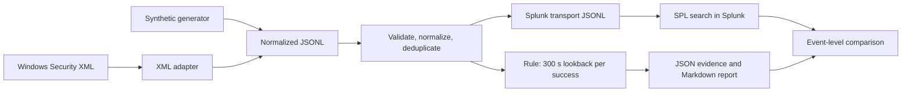

# SOC Detection Lab

Detection and investigation of **repeated failed Windows logons followed by a successful logon**: a Python reference implementation, a Splunk SPL translation, and an end-to-end check with genuine events from an owned Windows 11 test VM.

The guiding question is whether every alert can be traced to concrete events and a defensible analyst assessment. A matching pattern is a reason to investigate, not proof of an attack or account compromise.

[Project status](docs/project-status.md) · [Validation record](docs/validation.md) · [Splunk validation](docs/splunk-validation.md)

## What the project covers

- **Detection from a hypothesis:** at least five failed logons (4625), then a success (4624) for the same domain, user, source IP, destination host and logon type within 300 seconds.
- **Data quality first:** schema validation, normalization, deduplication, and explicit exclusions with reasons instead of silent drops.
- **Evidence per alert:** every alert lists the exact failure and success events with UID, timestamp, Windows RecordID and original SystemTime.
- **Native telemetry:** SMB logons from a Mac against an owned Windows 11 VM, exported as Windows Event XML and converted by a precision-aware adapter.
- **SIEM translation:** the same rule in SPL, executed on Splunk Enterprise 10.2.6 and compared with the Python results event by event.
- **Analyst work:** three worked investigations with suspicious, legitimate and unresolved outcomes, a triage playbook and documented limitations.

## Results

| Dataset | Events | Python | Splunk 10.2.6 |
| --- | --- | --- | --- |
| Native capture, own Windows 11 VM (private) | 12 exported, 8 in rule scope | 1 alert: success 53330 after failures 53325–53329 | identical |
| [Synthetic boundary cases](data/splunk-boundaries/README.md) | 14 | 2 alerts: same-microsecond tie, exact 300-second boundary | identical |
| Synthetic demo | 24 lines, 23 unique, 1 duplicate | 3 alerts, see [examples](reports/examples/) | not run |

- The expected alert for the native capture was fixed **before** the detector ran and was met unchanged. A pilot success with only one preceding failure correctly produced no alert, and four SYSTEM logons were reported as out of scope.
- Before running the detection in Splunk, an inventory search confirmed that every event arrived and that the indexed `_time` matches the source timestamp to the microsecond.
- The Splunk run exposed two defects in the queries: a time-zone-dependent timestamp check, and a `json_extract` call that Splunk 10.2.6 rejects inside `mvmap`. A failed search also returned exit code 0 with empty output. Both defects were fixed and the searches re-run; see the [validation record](docs/splunk-validation.md#validation-record-2026-10-06).

## How it works



For each successful logon at time `t`, the rule counts deduplicated failures with the same key in `[t − 300 s, t)`. The lower boundary counts. At equal microseconds, a failure with a lower Windows RecordID counts as earlier. Logon types 3 (Network) and 10 (RemoteInteractive) are evaluated separately. An earlier success does not reset the window, so two qualifying successes produce two alerts. Alert IDs are stable hashes of rule, parameters and success content. Full specification: [detection logic](docs/detection-logic.md).

Native Windows timestamps have 100-ns precision. The adapter truncates them to microseconds by string operation, never rounds, and keeps the original SystemTime and RecordID with every event. See the [XML mapping and precision contract](docs/windows-export-format.md).

## Quickstart

Requires Python 3.11 or newer. Runtime uses only the standard library; pytest is the only development dependency.

```sh
python3 -m venv .venv
source .venv/bin/activate
python -m pip install -e '.[dev]'
python -m soc_detection_lab generate --output data/generated --seed 42
python -m soc_detection_lab validate --input data/generated/events.jsonl
python -m soc_detection_lab analyze --input data/generated/events.jsonl --output reports/generated
python -m soc_detection_lab evaluate --input data/evaluation/events.jsonl --expected data/evaluation/expected.json
python -m pytest
```

On Windows PowerShell, activate with `.venv\Scripts\Activate.ps1`; this path has not been tested. After installation everything runs offline.

The demo writes `reports/generated/report.md` (timeline and evidence), `results.json` (structured alerts), `normalized.jsonl` (clean events for re-analysis) and `splunk-import.jsonl` (transport format for Splunk). Generation with seed `42` reproduces the [versioned example](reports/examples/demo-report.md).

### Windows Event XML

The repository contains only synthetic XML. The same commands apply to an own export from `scripts/windows/Export-LogonEvents.ps1`:

```sh
python -m soc_detection_lab inspect-windows-xml --input data/documentation-examples/security-structure.xml
python -m soc_detection_lab adapt-windows-xml --input data/splunk-boundaries/events.xml --output reports/generated/splunk-boundaries/adapter --data-origin synthetic
python -m soc_detection_lab analyze --input reports/generated/splunk-boundaries/adapter/events.jsonl --output reports/generated/splunk-boundaries/analysis
python -m soc_detection_lab evaluate --input reports/generated/splunk-boundaries/adapter/events.jsonl --expected data/splunk-boundaries/expected.json
```

The adapter emits only complete 4624/4625 events of logon type 3 or 10 and reports every other event with a reason.

### Splunk

The SPL query, an import inventory query, two comparison scripts and a local app configuration (index, sourcetype with microsecond timestamp parsing, loopback binding) are in [`queries/splunk/`](queries/splunk/). The [macOS runbook](docs/splunk-macos-runbook.md) covers installation in the user directory, Oneshot import, searches, comparison and removal.

## Investigations

- [SYN-001](reports/examples/SYN-001-suspicious.md): suspicious pattern, detailed investigation
- [SYN-002](reports/examples/SYN-002-legitimate.md): legitimate activity that exceeds the threshold
- [SYN-003](reports/examples/SYN-003-unresolved.md): unresolved because context is missing

Event data, synthetic context and expected results are kept in separate files. The detector reads only event data.

## Repository layout

| Path | Content |
| --- | --- |
| `src/soc_detection_lab/` | CLI, detection engine, XML inspector and adapter, report generation |
| `tests/` | pytest suite (178 tests including the Splunk comparison scripts) |
| `detections/` | Rule definition with parameters and sources |
| `data/` | Synthetic demo fixtures, evaluation set, boundary dataset, documentation XML |
| `queries/splunk/` | SPL queries, comparison scripts, local Splunk app configuration |
| `scripts/windows/` | PowerShell used to prepare the test VM and export events |
| `reports/examples/` | Demo report and the three investigations |
| `docs/` | Specification, validation, runbooks, limitations; [`docs/history/`](docs/history/README.md) keeps the VM setup and troubleshooting notes |

## CLI behavior

Run `python -m soc_detection_lab --help` and `<command> --help` for all options.

- **Rule parameters:** `--threshold`, `--window-seconds`, `--logon-types`. Defaults are didactic lab settings, not production recommendations.
- **Input limits:** `--max-bytes` (default 10 MiB) and `--max-events` (default 100000); analysis also aborts above 100000 evidence references. This is an in-memory batch tool.
- **Errors:** missing correlation values produce reported exclusions. Structurally invalid lines abort the run unless `--skip-invalid` is set; conflicting content for one UID always aborts.
- **Exit codes:** `0` processing completed (possibly with reported exclusions), `2` input, configuration or limit failure, `3` evaluation differs from expected results.

## Scope and limits

All versioned event and context data are synthetic and use neutral identities and documentation IP addresses. The native capture and its reports are private and not part of the repository. Tests and the Splunk comparison establish behavior on these specific datasets; they do not measure production detection coverage or prove general Python/SPL equivalence.

The rule misses distributed sources, slow attempts, password spraying across accounts, missing telemetry and unselected logon types. Stored stale credentials can trigger it legitimately. No response actions run automatically. Details: [limitations](docs/limitations.md).

No employer affiliation, production SOC experience, certification or production SIEM deployment is claimed.

## Documentation

- [Data model](docs/data-model.md), [detection logic](docs/detection-logic.md), [Windows XML contract](docs/windows-export-format.md)
- [Triage playbook](docs/triage-playbook.md), [limitations](docs/limitations.md), [learning notes](docs/learning-notes.md), [SYN-001 code walkthrough](docs/syn-001-code-walkthrough.md)
- [Splunk validation](docs/splunk-validation.md), [macOS runbook](docs/splunk-macos-runbook.md), [validation record](docs/validation.md)
- [Windows lab plan](docs/windows-lab-plan.md), [setup history](docs/history/README.md), [roadmap](docs/roadmap.md)
- [Sources](docs/sources.md) and [development-tool disclosure](docs/ai-assistance.md)

## License

Released under the [MIT License](LICENSE).
